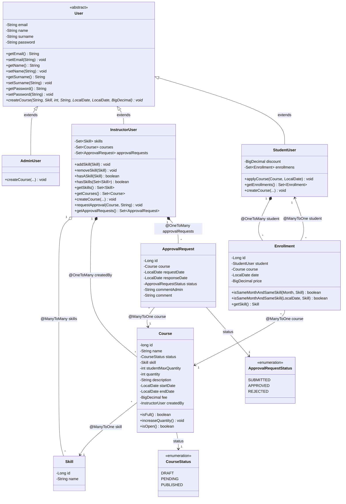
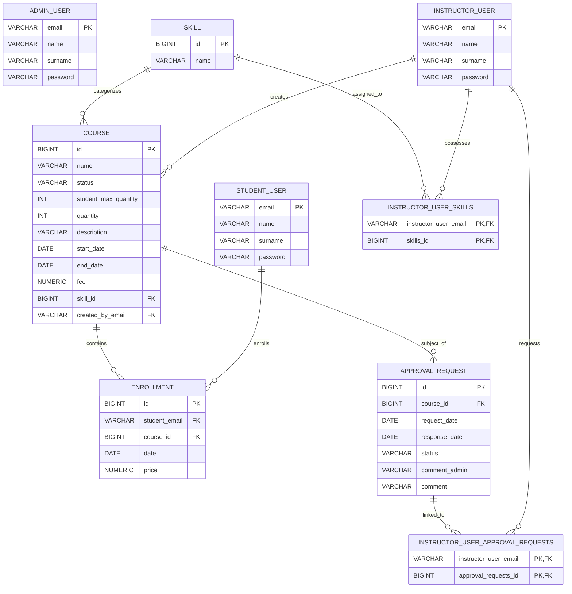

# E-Learning Platform Domain Model (Spring Boot & JPA)

A Spring Boot application implementing an e-learning platform domain model with Spring Data JPA, Hibernate, and an H2 database.

---

## Table of Contents

- [Overview](#overview)
- [Domain Model & Entities](#domain-model--entities)
- [Class & Relationship Overview](#class--relationship-overview)
- [Key Features & Business Logic](#key-features--business-logic)
- [Service & REST API Layer](#service--rest-api-layer)
- [Repositories](#repositories)
- [Configuration & Logging](#configuration--logging-applicationproperties)
- [Project Structure](#project-structure)
- [Prerequisites](#prerequisites)
- [Building & Testing](#building--testing)
- [Running the Application](#running-the-application)

---

## Overview

This project implements an e-learning platform system with a layered Spring Boot architecture:
- **Polymorphic User Management**: Role hierarchy (`AdminUser`, `InstructorUser`, `StudentUser`) inheriting from an abstract `User` base entity using Table-per-Class inheritance.
- **Course Lifecycle**: Courses with lifecycle statuses (`CourseStatus`: `DRAFT`, `PENDING`, `PUBLISHED`), date windows (`startDate`, `endDate`), capacity controls (`studentMaxQuantity`, `quantity`), fee (`fee`), and skill associations (`Skill`).
- **Course Creation & Approval Workflow**: Instructors create courses in `DRAFT` status and request administrative approval via `ApprovalRequest` (`ApprovalRequestStatus`: `SUBMITTED`, `APPROVED`, `REJECTED`), transitioning courses to `PENDING`.
- **Course Enrollment & Bundled Discounts**: Students enroll in published, open courses (`Enrollment`). When a student enrolls in multiple courses with the same skill within the same calendar month, an externalized discount (configured via `student.discount` in `application.properties`) is automatically applied.
- **Service & REST API Layer**: Clean separation of concerns with REST controllers (`InstructorResource`), DTOs (`CreateInstructorRequestDTO`), ModelMapper configuration (`ModelMapperConfig`), service abstractions (`InstructorService`), and custom exception handling (`EmailAlreadyExistsException`).
- **Spring Data JPA Repositories**: Complete repository layer providing CRUD and specialized query capabilities for users, skills, courses, enrollments, and approval requests.

---

## Domain Model & Entities

### 1. `User` (Abstract Base Entity)
- **Inheritance**: `@Inheritance(strategy = InheritanceType.TABLE_PER_CLASS)`
- **Attributes**: `email` (PK), `name`, `surname`, `password`
- **Abstract Method**:
  ```java
  public abstract void createCourse(String name, Skill skill, int studentMaxQuantity, 
      String description, LocalDate startDate, LocalDate endDate, BigDecimal fee);
  ```

### 2. `AdminUser`
- Extends `User` with `@DiscriminatorValue("Admin")`

### 3. `InstructorUser`
- Extends `User` with `@DiscriminatorValue("Instructor")`
- **Relationships**:
  - Many-to-Many with `Skill` (`Set<Skill> skills`)
  - One-to-Many with `Course` (`@OneToMany(mappedBy = "createdBy", cascade = CascadeType.ALL) Set<Course> courses`)
  - One-to-Many with `ApprovalRequest` (`@OneToMany Set<ApprovalRequest> approvalRequests`)
- **Domain Methods**:
  - `addSkill(Skill s)`, `removeSkill(Skill s)`, `hasASkill(Skill s)`, `hasSkills(Set<Skill> skills)`
  - `getSkills()`: Returns an unmodifiable `Set<Skill>` view.
  - `getCourses()`: Returns an unmodifiable `Set<Course>` view.
  - `createCourse(...)`: Instantiates a `Course` with `status = DRAFT`, sets `createdBy = this`, and associates it with the instructor.
  - `requestApproval(Course c, String comment)`: Submits an `ApprovalRequest` with status `SUBMITTED`, switches the course status to `PENDING`, and records it in `approvalRequests`. Throws `NoOwnerCourseException` if the instructor does not own the course, or `NoDraftCourseException` if the course is not in `DRAFT` status.
  - `getApprovalRequests()`: Returns an unmodifiable `Set<ApprovalRequest>` view.

### 4. `StudentUser`
- Extends `User` with `@DiscriminatorValue("Student")`
- **Relationships**:
  - One-to-Many with `Enrollment` (`@OneToMany(mappedBy = "student", cascade = CascadeType.ALL) Set<Enrollment> enrollmens`)
- **Domain Methods**:
  - `applyCourse(Course course, LocalDate date)`: Enrolls the student in a course.
    - Validates course is `PUBLISHED` (throws `NoPublishStatusException`).
    - Validates course is not full (throws `FullCourseException`).
    - Validates course registration is open today (throws `ClosedCourseException`).
    - Applies a discount (default 25%, externalized in `application.properties`) if `hasDiscount(course, date)` is true (i.e. student already has another enrollment with the same skill in the same calendar month).
    - Creates and records `Enrollment(this, course, date, payment)`.
    - Increments course enrollment count via `course.increaseQuantity()`.
  - `getEnrollments()`: Returns an unmodifiable `Set<Enrollment>` view.
  - `setDiscount(BigDecimal)` / `getDiscount()`: Configures the discount percentage.

### 5. `Course`
- **Attributes**:
  - `id` (`long`, `@Id @GeneratedValue(strategy = GenerationType.IDENTITY)`)
  - `name` (`String`)
  - `status` (`CourseStatus`: `DRAFT`, `PENDING`, `PUBLISHED`)
  - `skill` (`Skill`, `@ManyToOne`)
  - `studentMaxQuantity` (`int`): Maximum capacity.
  - `quantity` (`int`): Current enrolled student count.
  - `description` (`String`)
  - `startDate` (`LocalDate`, columnDefinition = "DATE")
  - `endDate` (`LocalDate`, columnDefinition = "DATE")
  - `fee` (`BigDecimal`, precision = 20, scale = 2)
  - `createdBy` (`InstructorUser`, `@ManyToOne`)
- **Domain Methods**:
  - `isFull()`: Returns `true` if `quantity >= studentMaxQuantity`.
  - `increaseQuantity()`: Increments `quantity`.
  - `isOpen()`: Returns `true` if current date (`LocalDate.now()`) is between `startDate` and `endDate`.

### 6. `Enrollment` (Association Entity)
- Represents a student enrollment in a course.
- **Attributes**:
  - `id` (`Long`, `@Id @GeneratedValue(strategy = GenerationType.IDENTITY)`)
  - `student` (`StudentUser`, `@ManyToOne`)
  - `course` (`Course`, `@ManyToOne`)
  - `date` (`LocalDate`, columnDefinition = "DATE")
  - `price` (`BigDecimal`, precision = 20, scale = 2)
- **Domain Methods**:
  - `isSameMonthAndSameSkill(Month m, Skill s)`: Returns `true` if the enrollment date's month equals `m` and the enrolled course's skill equals `s`.
  - `isSameMonthAndSameSkill(LocalDate d, Skill s)`: Overload accepting a `LocalDate`.

### 7. `ApprovalRequest`
- Represents a course publication approval request submitted by an instructor.
- **Attributes**:
  - `id` (`Long`, `@Id @GeneratedValue(strategy = GenerationType.IDENTITY)`)
  - `course` (`Course`, `@ManyToOne`)
  - `requestDate` (`LocalDate`, columnDefinition = "DATE")
  - `responseDate` (`LocalDate`, columnDefinition = "DATE")
  - `status` (`ApprovalRequestStatus`: `SUBMITTED`, `APPROVED`, `REJECTED`)
  - `commentAdmin` (`String`)
  - `comment` (`String`)

### 8. `Skill`
- Competency topic associated with instructors and courses.
- **Attributes**: `id` (`Long`, `@Id @GeneratedValue(strategy = GenerationType.IDENTITY)`), `name` (`String`)

---

## Class & Relationship Overview

### Class Diagram



### Entity-Relationship Diagram (ERD)




---

## Key Features & Business Logic

- **JPA Table-per-Class Inheritance**: Clean relational representation of users (`AdminUser`, `InstructorUser`, `StudentUser`) with polymorphic querying over `User.class`.
- **Course Enrollment Validation**:
  - Enforces course status (`PUBLISHED`), capacity limit (`quantity < studentMaxQuantity`), and date window validity (`today` between `startDate` and `endDate`).
  - Throws custom domain exceptions: `NoPublishStatusException`, `FullCourseException`, `ClosedCourseException`.
- **Bundled Enrollment Discount**:
  - If a student applies to multiple courses sharing the same skill within the same calendar month, subsequent enrollments automatically receive a 25% discount.
  - Calculated with `RoundingMode.HALF_UP` to two decimal places.
- **Externalized Configuration**:
  - The student discount percentage is externalized to `application.properties` via `student.discount=25` and dynamically bound to `StudentUser`.
- **Course Approval Workflow**:
  - Instructors submit draft courses for publication review via `requestApproval(...)`.
  - Enforces that only draft courses owned by the instructor can be submitted (`NoOwnerCourseException`, `NoDraftCourseException`).
- **Encapsulation & Immutability**:
  - Entity collections (`getSkills()`, `getCourses()`, `getEnrollments()`, `getApprovalRequests()`) return unmodifiable views via `Collections.unmodifiableSet(...)`.

---

## Service & REST API Layer

### REST Controller: `InstructorResource`
- **Base Endpoint**: `/instructors`
- **`POST /instructors`**:
  - Accepts a JSON payload mapped to `CreateInstructorRequestDTO` (`email`, `password`).
  - Maps `CreateInstructorRequestDTO` to `InstructorUser` via `ModelMapper`.
  - Calls `instructorService.create(instructor)`.
  - **Success Response**: `201 CREATED` with an empty body.
  - **Error Response**: `409 CONFLICT` with the exception message in the response body if `EmailAlreadyExistsException` or any other error occurs.

#### cURL Examples

**1. Create a New Instructor (`201 Created`)**
```bash
curl -i -X POST http://localhost:8080/instructors \
  -H "Content-Type: application/json" \
  -d '{
    "email": "jane.doe@example.com",
    "password": "Password123!"
  }'
```

*Expected Response (`201 Created` with empty body):*
```http
HTTP/1.1 201 Created
Date: Fri, 16 Oct 2026 16:50:00 GMT
Content-Length: 0
```

**2. Duplicate Email Registration Attempt (`409 Conflict`)**
```bash
curl -i -X POST http://localhost:8080/instructors \
  -H "Content-Type: application/json" \
  -d '{
    "email": "jane.doe@example.com",
    "password": "Password123!"
  }'
```

*Expected Response (`409 Conflict` with error message in body):*
```http
HTTP/1.1 409 Conflict
Content-Type: text/plain;charset=UTF-8
Content-Length: 43

Email already exists: jane.doe@example.com
```

### Service Layer: `InstructorService` & `InstructorServiceImp`
- **Interface**: `InstructorService`
  - `void create(InstructorUser instructor) throws EmailAlreadyExistsException`
- **Implementation**: `InstructorServiceImp`
  - Validates that an instructor with the given email does not already exist via `InstructorUserRepository.existsByEmail(email)`.
  - Throws `EmailAlreadyExistsException("Email already exists: " + email)` if duplicate.
  - Persists the new `InstructorUser` entity using `instructorUserRepository.save(instructor)`.

### Data Transfer Objects (DTO)
- **`CreateInstructorRequestDTO`**:
  - `email` (`String`)
  - `password` (`String`)

---

## Repositories

The project leverages Spring Data JPA repositories with specialized query methods:

| Repository | Entity | Key Methods |
|---|---|---|
| `UserRepository` | `User` | `findByEmail(String)`, `existsByEmail(String)` |
| `AdminUserRepository` | `AdminUser` | `findByEmail(String)`, `existsByEmail(String)` |
| `InstructorUserRepository` | `InstructorUser` | `findByEmail(String)`, `existsByEmail(String)`, `findBySkillsContaining(Skill)` |
| `StudentUserRepository` | `StudentUser` | `findByEmail(String)`, `existsByEmail(String)` |
| `SkillRepository` | `Skill` | `findByName(String)`, `existsByName(String)` |
| `CourseRepository` | `Course` | `findByStatus(CourseStatus)`, `findBySkill(Skill)`, `findBySkillId(Long)`, `findByCreatedBy(InstructorUser)`, `findByCreatedByEmail(String)` |
| `EnrollmentRepository` | `Enrollment` | `findByStudent(StudentUser)`, `findByStudentEmail(String)`, `findByCourse(Course)`, `findByCourseId(Long)` |
| `ApprovalRequestRepository` | `ApprovalRequest` | `findByStatus(ApprovalRequestStatus)`, `findByCourse(Course)`, `findByCourseId(Long)` |

---

## Configuration & Logging (`application.properties`)

All logging and application configuration is managed directly in `demo/src/main/resources/application.properties`:

```properties
spring.application.name=demo
student.discount=25

# Logging Levels
logging.level.root=INFO
logging.level.com.example.demo=DEBUG
logging.level.org.springframework.web=INFO
logging.level.org.hibernate.SQL=DEBUG

# Console Formatting
logging.pattern.console=%clr(%d{yyyy-MM-dd HH:mm:ss.SSS}){faint} %clr(%5p) %clr(${PID:- }){magenta} %clr(---){faint} %clr([%15.15t]){faint} %clr(%-40.40logger{39}){cyan} %clr(:){faint} %m%n%wEx

# File Output & Rolling Policy
logging.file.name=logs/application.log
logging.pattern.file=%d{yyyy-MM-dd HH:mm:ss.SSS} [%thread] %-5level %logger{36} - %msg%n
logging.logback.rollingpolicy.file-name-pattern=logs/archived/application-%d{yyyy-MM-dd}.%i.log
logging.logback.rollingpolicy.max-file-size=10MB
logging.logback.rollingpolicy.max-history=30
logging.logback.rollingpolicy.total-size-cap=1GB
```

- **No XML File Needed**: Spring Boot includes full native support for Logback configuration directly through properties, including log levels, formatting patterns, console coloring, file destinations, and rolling/retention policies.
- **HTTP Request Logging**: `CommonsRequestLoggingFilter` configured in `LoggingConfig` logs incoming web requests (client info, query strings, payloads).
- **ModelMapper Bean Configuration**: `ModelMapperConfig` defines the `ModelMapper` bean used across the application to map between request DTOs and persistent domain entities.

---

## Project Structure

```
demo/
├── pom.xml
├── mvnw
├── mvnw.cmd
└── src/
    ├── main/
    │   ├── java/com/example/demo/
    │   │   ├── DemoApplication.java
    │   │   ├── config/
    │   │   │   ├── LoggingConfig.java
    │   │   │   └── ModelMapperConfig.java
    │   │   ├── dto/
    │   │   │   └── CreateInstructorRequestDTO.java
    │   │   ├── entity/
    │   │   │   ├── AdminUser.java
    │   │   │   ├── ApprovalRequest.java
    │   │   │   ├── ApprovalRequestStatus.java
    │   │   │   ├── Course.java
    │   │   │   ├── CourseStatus.java
    │   │   │   ├── Enrollment.java
    │   │   │   ├── InstructorUser.java
    │   │   │   ├── Skill.java
    │   │   │   ├── StudentUser.java
    │   │   │   └── User.java
    │   │   ├── exception/
    │   │   │   ├── ClosedCourseException.java
    │   │   │   ├── EmailAlreadyExistsException.java
    │   │   │   ├── FullCourseException.java
    │   │   │   ├── NoDraftCourseException.java
    │   │   │   ├── NoOwnerCourseException.java
    │   │   │   └── NoPublishStatusException.java
    │   │   ├── repository/
    │   │   │   ├── AdminUserRepository.java
    │   │   │   ├── ApprovalRequestRepository.java
    │   │   │   ├── CourseRepository.java
    │   │   │   ├── EnrollmentRepository.java
    │   │   │   ├── InstructorUserRepository.java
    │   │   │   ├── SkillRepository.java
    │   │   │   ├── StudentUserRepository.java
    │   │   │   └── UserRepository.java
    │   │   ├── resource/
    │   │   │   └── InstructorResource.java
    │   │   └── service/
    │   │       ├── InstructorService.java
    │   │       └── InstructorServiceImp.java
    │   └── resources/
    │       ├── application.properties
    │       └── static/
    │           └── index.html
    └── test/
        └── java/com/example/demo/
            ├── DemoApplicationTests.java
            ├── config/
            │   ├── LoggingConfigTest.java
            │   └── ModelMapperConfigTest.java
            ├── entity/
            │   ├── AdminUserTest.java
            │   ├── CourseTest.java
            │   ├── InstructorUserTest.java
            │   ├── SkillEntityTest.java
            │   └── StudentUserTest.java
            ├── repository/
            │   └── RepositoryIntegrationTest.java
            ├── resource/
            │   └── InstructorResourceTest.java
            └── service/
                └── InstructorServiceImpTest.java
```

---

## Prerequisites

- **Java Development Kit (JDK)**: Java 17 or higher
- **Maven**: Bundled Maven wrapper (`./mvnw`) is included

---

## Building & Testing

### Run All Unit and Integration Tests
```bash
cd demo
./mvnw clean test
```

### Build JAR Package
```bash
cd demo
./mvnw clean package
```

### Test Coverage Highlights (78 Total Tests)
- **`StudentUserTest` (21 tests)**: Tests course application flow, capacity check exceptions (`FullCourseException`), publication status checks (`NoPublishStatusException`), availability date checks (`ClosedCourseException`), same-month/same-skill discount calculation (including `RoundingMode.HALF_UP`), discount externalization via `application.properties`, unmodifiable collection enforcement, and JPA persistence.
- **`InstructorUserTest` (19 tests)**: Tests `Skill` relationships and helper methods (`addSkill`, `removeSkill`, `hasASkill`, `hasSkills`), Course creation (`createCourse`), Course cascade persistence and deletion, and polymorphic user retrieval.
- **`CourseTest` (10 tests)**: Tests Course instantiation, Lombok builder, lifecycle statuses (`CourseStatus`), `@ManyToOne` association with `Skill`, `quantity` increment logic, `LocalDate` start/end date handling, `BigDecimal` fee persistence, and updates.
- **`AdminUserTest` (7 tests)**: Tests inheritance, entity persistence, updates, deletion, discriminator values, and polymorphic querying via `User.class`.
- **`RepositoryIntegrationTest` (6 tests)**: Integration tests verifying persistence, queries, and constraints across all 8 Spring Data JPA repositories (`UserRepository`, `AdminUserRepository`, `InstructorUserRepository`, `StudentUserRepository`, `SkillRepository`, `CourseRepository`, `EnrollmentRepository`, and `ApprovalRequestRepository`).
- **`InstructorResourceTest` (5 tests)**: WebMvc slice tests with `MockMvc` verifying the `POST /instructors` REST endpoint: JSON body deserialization, HTTP 201 Created status, HTTP 409 Conflict handling for duplicate emails (`EmailAlreadyExistsException`), error responses on mapper failures, and null message handling.
- **`SkillEntityTest` (3 tests)**: Tests persistence, updates, and deletion for `Skill`.
- **`ModelMapperConfigTest` (2 tests)**: Tests ModelMapper bean creation and mapping from `CreateInstructorRequestDTO` to `InstructorUser`.
- **`InstructorServiceImpTest` (2 tests)**: Mockito unit tests verifying successful instructor creation when email is unique and throwing `EmailAlreadyExistsException` when email already exists.
- **`LoggingConfigTest` (2 tests)**: Verifies `CommonsRequestLoggingFilter` bean initialization and startup event logging.
- **`DemoApplicationTests` (1 test)**: Context loads verification.

---

## Running the Application

To run the Spring Boot application locally:

```bash
cd demo
./mvnw spring-boot:run
```

Once started:
- Web Page: [http://localhost:8080/index.html](http://localhost:8080/index.html)
- Embedded H2 in-memory database runs automatically during execution.
- Create an instructor via cURL:
  ```bash
  curl -i -X POST http://localhost:8080/instructors \
    -H "Content-Type: application/json" \
    -d '{"email": "instructor@example.com", "password": "password123"}'
  ```
